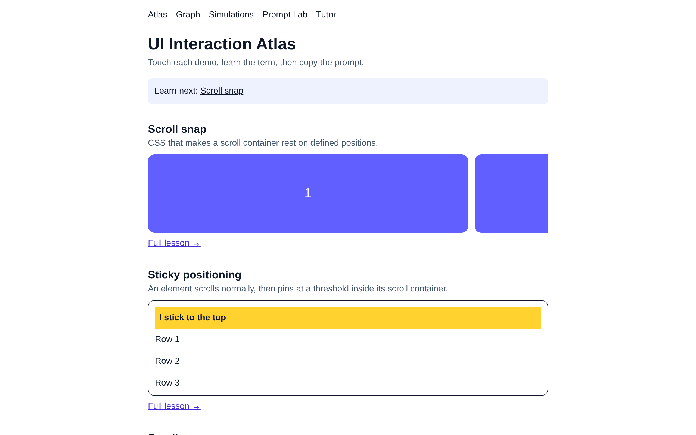
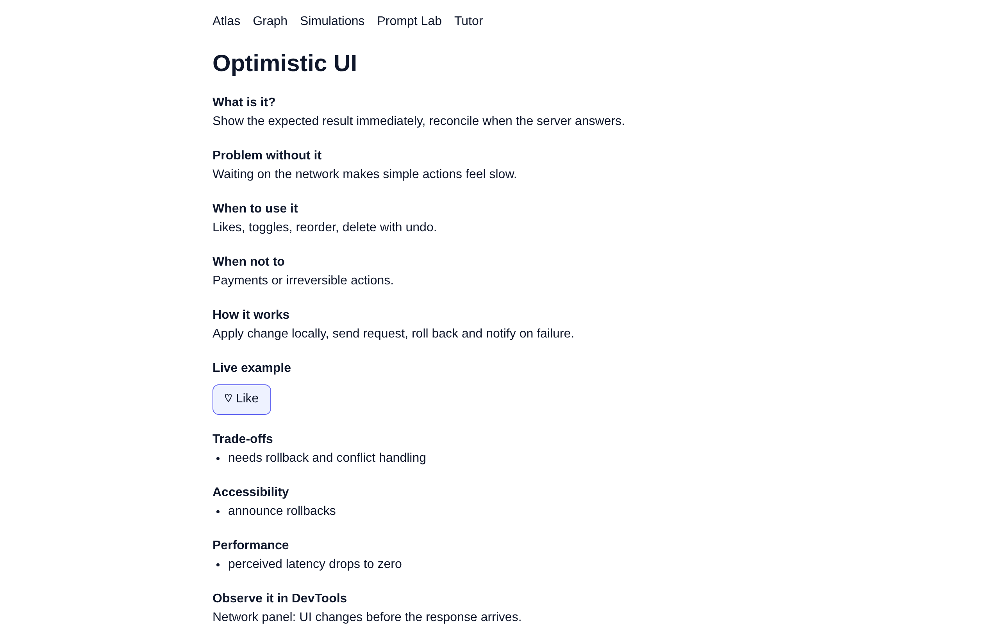
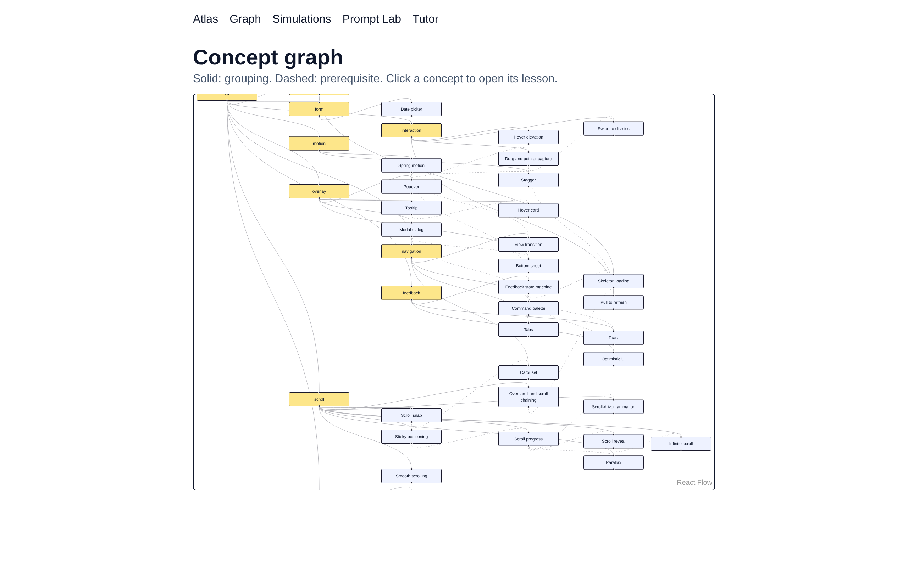
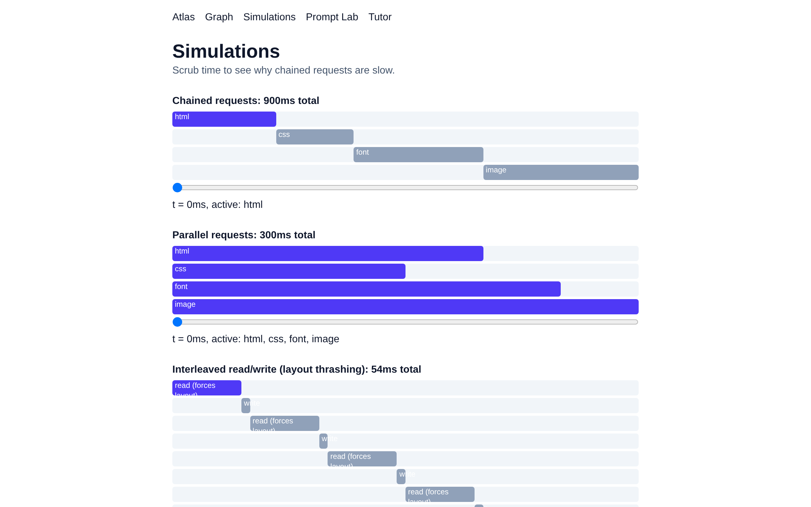
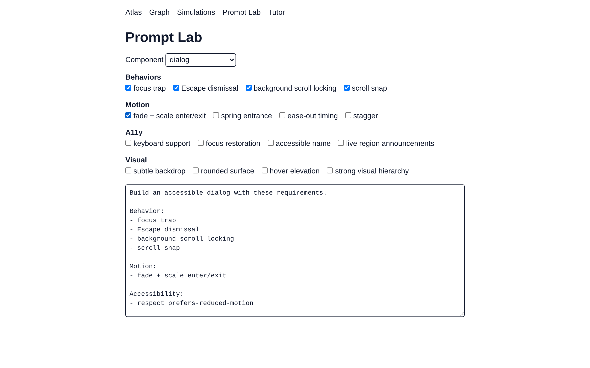
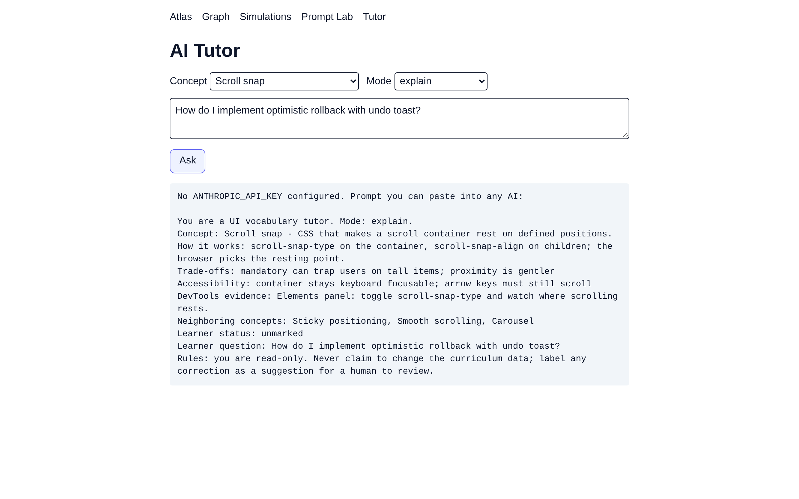

# UI Interaction Atlas 🗺️✨

> **Visual UI and interaction learning platform for engineers.** Master modern interaction patterns with live interactive demos, understand runtime performance and accessibility trade-offs, and generate precise prompts for AI/Codex.

[](https://nextjs.org/)
[](https://react.dev/)
[](https://tailwindcss.com/)
[](https://motion.dev/)
[](https://reactflow.dev/)
[](https://vitest.dev/)
[](https://playwright.dev/)

---

## 🌟 Overview

Building great software requires knowing more than basic layout. It requires deep intuition for **interaction physics**, **state machines**, **browser rendering lifecycles**, and **accessibility semantics**.

The **UI Interaction Atlas** bridges the gap between software engineering and interface design:
1. **Understand what a UI pattern is**: Interactive demos let you feel springs, overscroll behavior, optimistic rollback, and layout thrashing directly in the browser.
2. **Understand how the browser executes it**: Detailed breakdowns of compositing layers, reflow costs, keyboard focus management, and WCAG compliance.
3. **Prompt AI precisely**: Translate design intent into exact technical specifications and motion tokens for Codex, Claude, or GPT.

---

## 📸 Feature Showcase

### 1. Interactive Pattern Atlas & Learning Engine
Explore 30 fundamental UI interaction patterns across 9 categories (Scroll, Motion, Feedback, Overlay, Disclosure, Loading, Navigation, Interaction, and Forms). Each pattern includes an embedded sandbox to test interactions immediately, coupled with a prerequisite-aware "Next Up" recommendation engine.



---

### 2. Deep Lesson Contracts & Live Sandboxes
Every concept is treated as an architectural lesson contract:
- **Core Definition & Problem Statement**: Why the pattern exists and what fails without it.
- **When & When Not to Use**: Practical boundaries and anti-patterns.
- **Live Sandbox**: Native browser primitives (`<dialog>`, `popover`, `details/summary`, `scroll-snap`) and Motion spring physics.
- **Trade-offs, Accessibility & Performance**: Focus traps, keyboard navigation, `aria-*` semantics, layout thrash prevention, and compositor-friendly transformations.
- **DevTools Evidence & AI Prompts**: Concrete observation methods and ready-to-use prompt strings.



---

### 3. Layered Knowledge & Prerequisite Graph
Visualize topological dependencies and conceptual hierarchies. Rendered with `@xyflow/react` and layered using the **ELK** (Eclipse Layout Kernel) algorithm:
- **Solid edges**: Category and functional clustering.
- **Dashed edges**: Prerequisite dependencies for structured learning progression.
- **Interactive Nodes**: Click any concept node to navigate directly to its dedicated lesson.



---

### 4. Lifecycle & Performance Simulations
Scrub time interactively through critical browser execution lifecycles:
- **Chained vs. Parallel Requests**: Visualize network waterfall bottlenecks.
- **Layout Thrashing**: Compare interleaved DOM read/write reflow storms against batched mutations.
- **Optimistic vs. Pessimistic UI**: Contrast perceived user latency with network round-trip delays.
- **Virtualized DOM List**: Inspect rendering boundaries across 10,000 virtual rows with active DOM reuse.



---

### 5. Prompt Lab
Generate production-ready scaffolding prompts for AI assistants (Codex, Claude, ChatGPT). Configure component targets, interaction behaviors, motion tokens, accessibility standards, and visual polish to generate markdown prompts with zero hallucination.



---

### 6. Grounded AI Tutor
Interactive learning assistant with multiple instruction modes:
- **Explain**: Clarifies patterns and provides mental models.
- **Quiz**: Challenges your understanding of edge cases and trade-offs.
- **Critique**: Reviews interaction implementations for usability and accessibility flaws.
- **Code**: Generates tailored implementations grounded in the Atlas domain model.



---

## 🛠️ Architecture & Principles

- **Separation of Domain from View**: `lib/domain.ts` and `lib/sim.ts` contain zero React dependencies. Concept graphs, simulation timelines, and learning paths are pure TypeScript.
- **Explicit Motion Tokens**: Defined in `lib/tokens.ts` (duration, ease, springs) to eliminate arbitrary numbers and maintain consistent design language.
- **Finite State Machines**: Transition-table state machine in `lib/machine.ts` ensuring deterministic UI feedback states (`idle` -> `loading` -> `success` / `error`).
- **Native-First Interactions**: Prioritizes standard platform capabilities (`<dialog>`, `popover`, CSS `scroll-snap`, `details/summary`, CSS transitions) before adding JavaScript overhead.
- **First-Class Accessibility**: Every pattern specifies keyboard operability, screen reader live regions, focus restoration, and `prefers-reduced-motion` fallbacks.

---

## 💻 Tech Stack

| Category | Technology | Purpose |
| :--- | :--- | :--- |
| **Framework** | Next.js 16 (App Router, Turbopack) | Static site generation (SSG) & server routes |
| **UI Library** | React 19 | Component hierarchy & state management |
| **Styling** | Tailwind CSS v4 | Modern atomic utility styling |
| **Animations** | Motion v12 | Spring physics and layout animations |
| **Graphing** | `@xyflow/react` + `elkjs` | Directed dependency graph layout & rendering |
| **Testing** | Vitest 3 + Testing Library | Pure domain & component unit testing |
| **E2E & A11y** | Playwright + Axe Core | Cross-browser e2e tests & automated accessibility audits |
| **Deployment** | Vercel | Global edge CDN and serverless deployment |

---

## 🚀 Getting Started

### Prerequisites
- Node.js 20+ (Node.js 22+ recommended)
- npm or pnpm

### Installation

```bash
# Clone the repository
git clone https://github.com/paramcodes/ui-interaction.git
cd ui-interaction

# Install dependencies
npm install

# Run development server
npm run dev
```

Visit [http://localhost:3000](http://localhost:3000) to explore the Atlas locally.

---

## 🧪 Testing & Verification

```bash
# Run unit tests (domain logic, simulations, demo registry)
npm test

# Build for production (Turbopack + SSG)
npm run build

# Run end-to-end tests with Playwright and Axe accessibility audits
npm run e2e

# Run Lighthouse CI audits
npm run lighthouse
```

---

## 📂 Project Structure

```text
├── app/
│   ├── api/tutor/        # AI tutor API route
│   ├── concepts/[slug]/  # Deep concept lesson pages
│   ├── graph/            # Layered dependency graph (React Flow + ELK)
│   ├── prompt-lab/       # Codex prompt generator workspace
│   ├── simulations/      # Waterfall & layout thrash simulations
│   ├── tutor/            # Interactive AI tutor interface
│   ├── globals.css       # Tailwind v4 theme configuration
│   ├── layout.tsx        # Shell navigation & Core Web Vitals telemetry
│   └── page.tsx          # Atlas catalog home page
├── components/
│   ├── Demos.tsx         # Interactive demo registry for all 30 patterns
│   └── Vitals.tsx        # Web Vitals reporting component
├── docs/
│   ├── ARCHITECTURE.md   # Architectural decisions & system design
│   ├── DOMAIN.md         # Concept schema and taxonomy
│   └── MASTER-PLAN.md    # Multi-phase execution plan
├── lib/
│   ├── domain.ts         # Pure domain concepts, taxonomy & recommendation logic
│   ├── graph.ts          # Graph transformations for ELK layout
│   ├── machine.ts        # Transition-table finite state machine
│   ├── prompt.ts         # Prompt synthesis engine
│   ├── sim.ts            # Network waterfall & layout thrash timeline calculations
│   ├── tokens.ts         # Shared motion and timing tokens
│   └── tutor.ts          # Tutor prompt generator and context builder
├── public/
│   └── screenshots/      # Feature screenshots for documentation
└── vitest.config.ts      # Vitest test runner configuration
```

---

## 📄 License

MIT © [Param](https://github.com/paramcodes)
